# Genesys Cloud CX – Voice Security Firewall and Spam Call Blocking System


## Project Overview

This project demonstrates a voice security solution developed using **Genesys Cloud CX Architect**, Common Modules, Data Tables, and Data Actions.

The solution is designed to validate incoming callers, identify spam-related caller records, perform numeric challenge verification, and manage caller status through Genesys Cloud Data Tables and API integration.

The implementation demonstrates reusable Architect task integration, caller input validation, conditional routing, and automated Data Table updates.

## Project Objectives

- Implement caller identification using Genesys Cloud Data Tables.
- Retrieve spam caller and suspected spam caller status.
- Generate a random numeric verification challenge.
- Collect and validate caller input using Architect.
- Configure a maximum of three validation attempts.
- Integrate Genesys Cloud Data Actions with Data Tables.
- Update caller records through Genesys Cloud Platform API.
- Implement reusable Common Modules in Architect.
- Integrate the Common Module with an inbound call flow.
- Configure menu-based ACD queue transfers.

## Architecture and Solution Components

| Component | Description |
|---|---|
| Genesys Cloud Architect | Main platform for designing inbound call flows |
| Common Module | Reusable caller validation and spam-check logic |
| Data Table Lookup | Retrieves caller records using customer number |
| Data Actions | Executes API-based Data Table updates |
| Data Tables | Stores caller and spam-related information |
| Random Number Generation | Generates the numeric verification challenge |
| Loop | Controls the maximum number of validation attempts |
| Postman | Tests Genesys Cloud Platform API requests |
| Inbound Call Flow | Integrates the reusable Common Module |

## Solution Workflow

1. An incoming call reaches the Genesys Cloud inbound call flow.
2. The system plays the initial greeting.
3. The caller number is normalized and stored as participant data.
4. The inbound flow invokes the reusable `SPAM_CHECK` task.
5. The Common Module performs a Data Table Lookup using the caller number.
6. The system retrieves the caller's spam-related Boolean attributes.
7. Based on the configured decision logic, the flow follows the appropriate branch.
8. In the challenge verification branch, a random numeric value is generated.
9. The caller is prompted to enter the verification code.
10. Architect compares the entered value against the generated value.
11. A maximum of three attempts is configured for the validation loop.
12. The configured success and failure branches execute their respective actions.
13. A Genesys Cloud Data Action demonstrates updating the caller's Data Table record.
14. The inbound flow provides menu options for transferring callers to configured ACD queues.

## Data Table Structure

The project uses the following Data Table:

`2414_MD_SPAM_DB_DATA_TABLE`

| Column Name | Data Type | Description |
|---|---|---|
| customer_number | String | Unique caller number used for lookup |
| spam_caller_id | Boolean | Indicates whether the caller is identified as spam |
| suspect_spam_caller_id | Boolean | Indicates whether the caller is suspected of being spam |

### Data Table Lookup

The Common Module uses `Common.customer_number` as its lookup input.

The following outputs are mapped to task variables:

- `spam_caller_id` → `Task.spam_caller_id`
- `suspect_spam_caller_id` → `Task.suspect_spam_caller_id`

## Genesys Cloud API Integration

The project demonstrates updating an existing Data Table row using the Genesys Cloud Platform API.

**HTTP Method:** PUT

**API Endpoint:**

`/api/v2/flows/datatables/{datatableId}/rows/{rowId}`

**Example Request Body:**

```json
{
  "key": "<CUSTOMER_NUMBER>",
  "spam_caller_id": true,
  "suspect_spam_caller_id": false
}
```

Postman is used to demonstrate the API request for updating the existing Data Table record.

## Architect Configuration Screenshots

### 1. Data Table Lookup Configuration

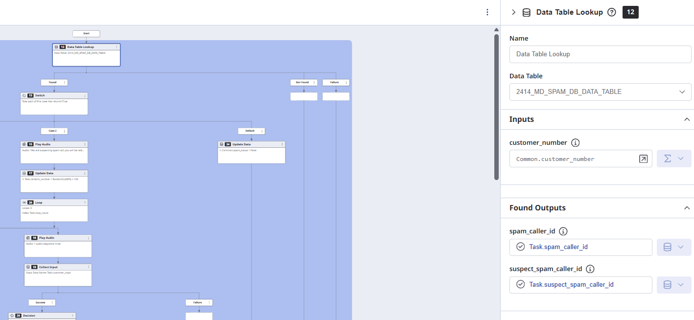

### 2. Common Module – Update Data

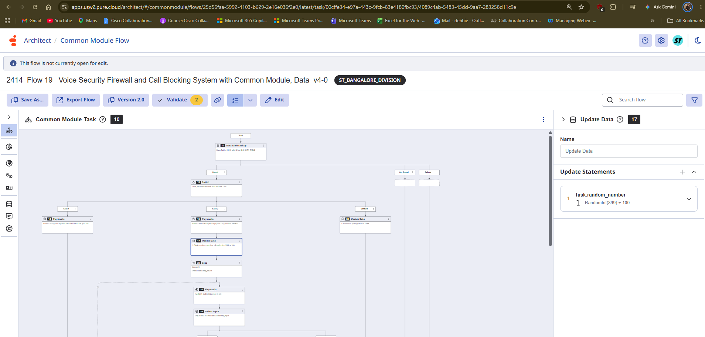

### 3. Random Number Generation and Three-Attempt Loop

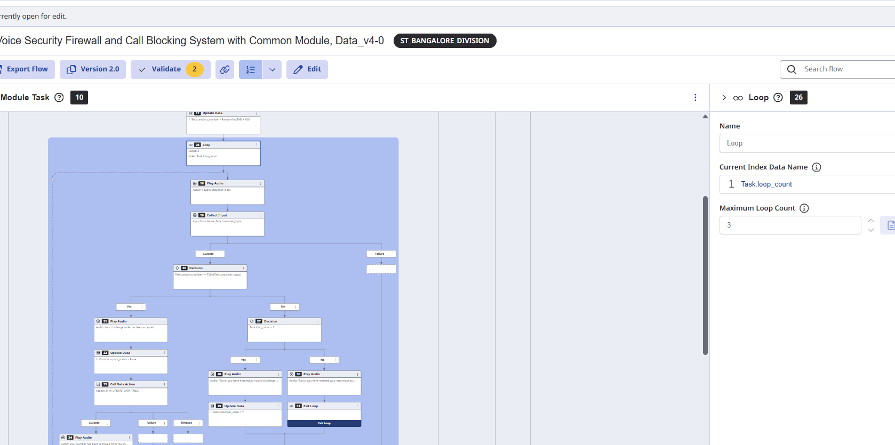

### 4. Verification Logic and Call Data Action

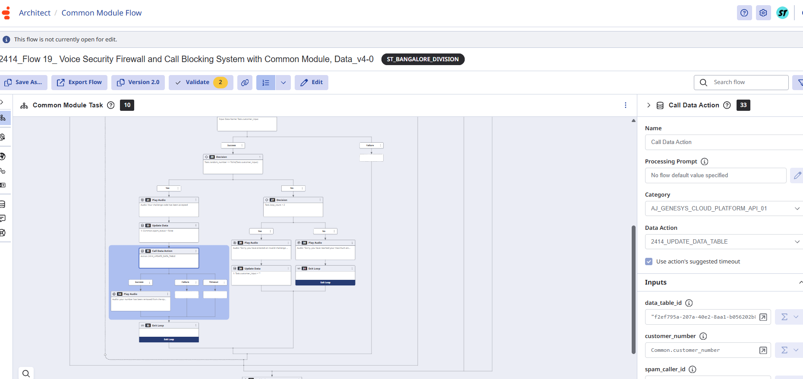

### 5. Common Module Flow Overview

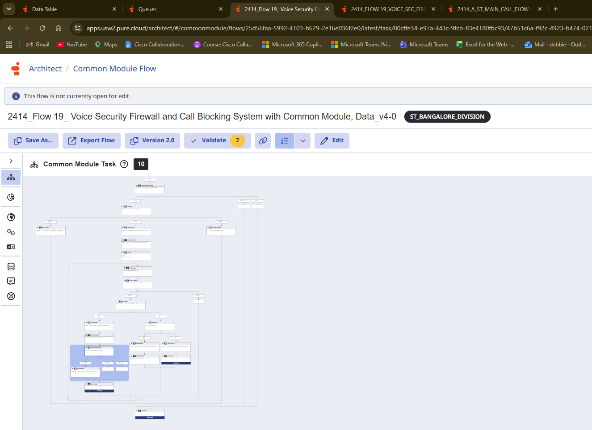

## Data Table and API Screenshots

### 6. Data Table Example Record

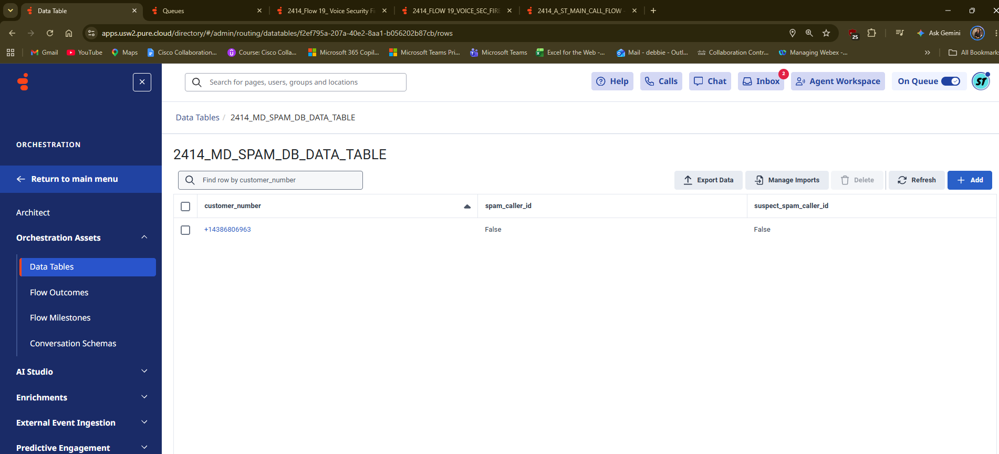

### 7. Audio Prompt Configuration

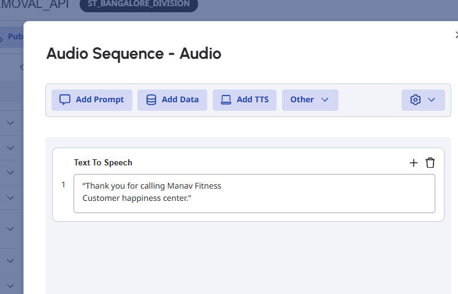

### 8. Postman – Data Table Update API Request

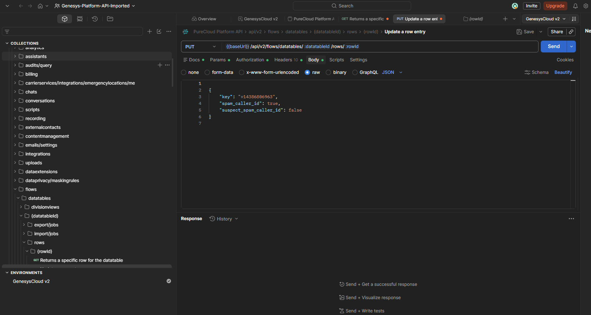

## Inbound Call Flow Screenshots

### 9. Inbound Flow – Starting Task

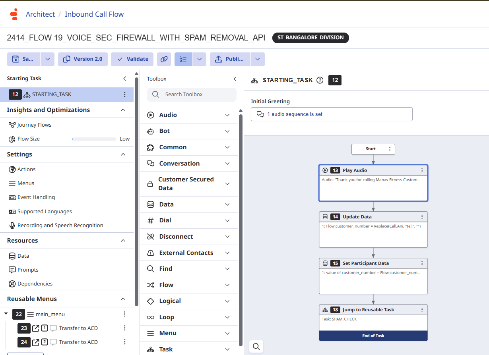

### 10. Menu Option One – ACD Transfer

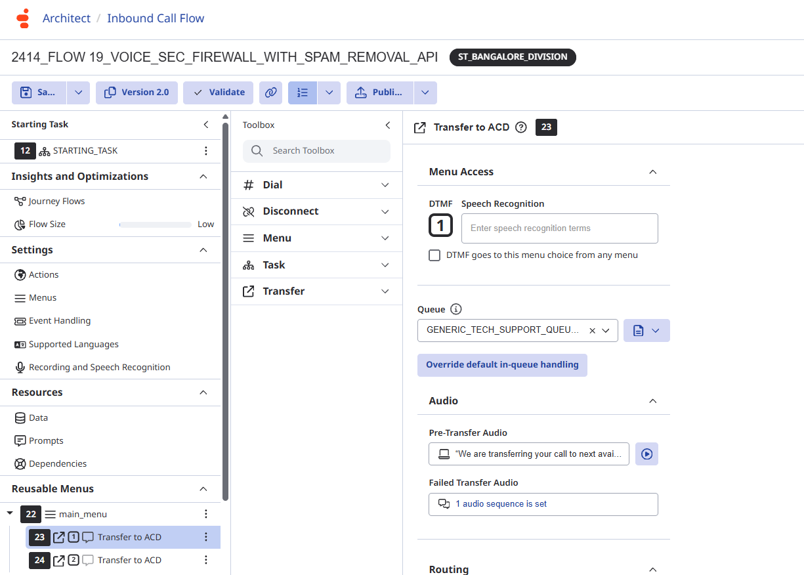

### 11. Menu Option Two – ACD Transfer

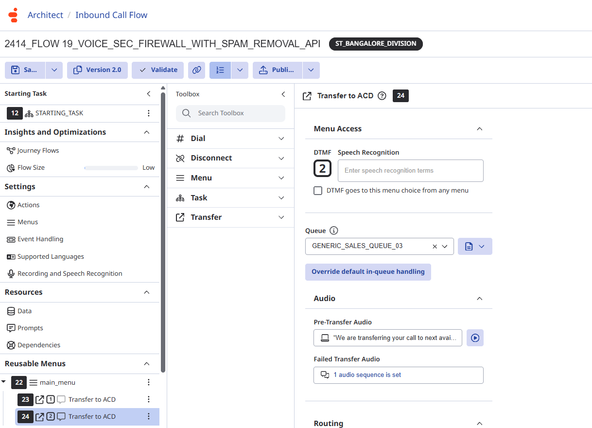

### 12. Common Module Integration

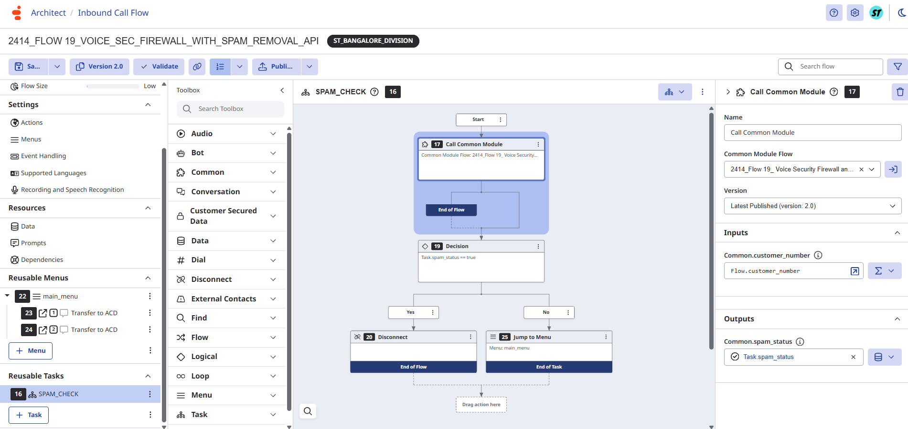

## Technologies and Tools

- Genesys Cloud CX
- Genesys Cloud Architect
- Architect Common Modules
- Reusable Tasks
- Genesys Cloud Data Tables
- Genesys Cloud Data Actions
- Genesys Cloud Platform API
- REST API
- Postman
- JSON
- ACD Queues and Inbound Call Routing

## Key Technical Skills Demonstrated

- Genesys Cloud Architect flow development
- Reusable Common Module implementation
- Data Table configuration and lookup
- Random number generation and caller input validation
- Loop and conditional decision handling
- Genesys Cloud Data Action integration
- REST API request configuration
- Postman API testing
- Inbound call routing and ACD queue configuration

## Disclaimer

This repository is a portfolio documentation of a Genesys Cloud CX voice security solution, based on configuration screenshots.

It is not a complete deployable solution or an official Genesys product.

All screenshots and configuration details should be shared only with appropriate permission. Customer information, phone numbers, tenant identifiers, credentials, and confidential organisation details must be removed or anonymized before public distribution.

---

**Project Category:** Contact Center Voice Security and Automation

**Platform:** Genesys Cloud CX

**Repository:** Genesys Cloud Voice Security Firewall and Spam Call Blocking System
